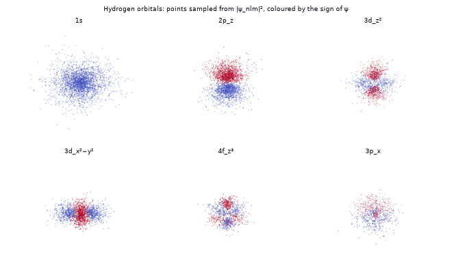
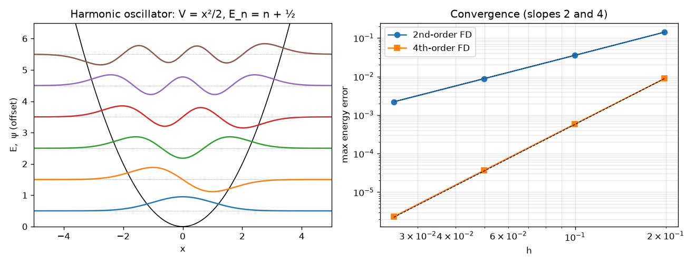
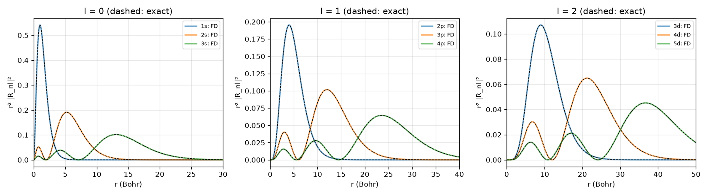
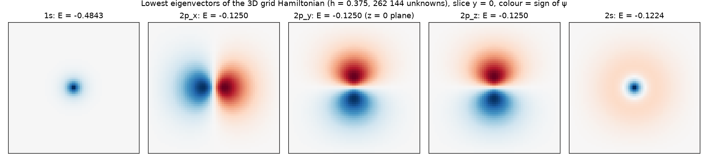
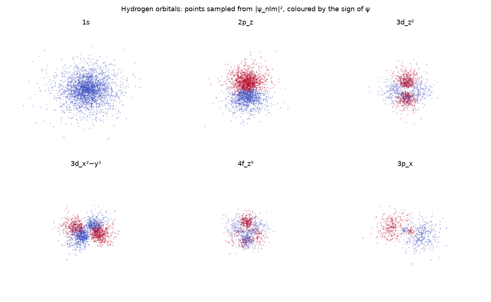

# Schrödinger Equation and Atomic Orbitals as Sparse Eigenvalue Problems

[](https://github.com/cfdgasman/schrodinger-orbitals/actions/workflows/ci.yml)

The time-independent Schrödinger equation, discretised with finite differences and solved as a **sparse eigenvalue problem**. It runs from a 1D oscillator to hydrogen on a **262 144-point 3D grid**, where the 1s, 2p and 2s orbitals emerge from plain linear algebra.

<p align="center"></p>

## Equations and discretisation

In atomic units (ħ = mₑ = e = 1):

$$ \hat H\psi = E\psi,\qquad \hat H = -\tfrac12\nabla^2 + V(\mathbf r). $$

On a grid, Ĥ becomes a sparse symmetric matrix H = −½Δ<sub>h</sub> + diag(V), and every eigenpair (E<sub>k</sub>, **ψ**<sub>k</sub>) is a bound state. Only a handful of the lowest eigenvalues of a very large matrix are needed, so the code uses **iterative eigensolvers**:
- **Shift-invert Lanczos** (ARPACK, `eigsh(sigma=…)`) factorises H − σI once. Eigenvalues near σ then become the dominant ones, which is ideal for 1D and radial problems.
- **Lanczos for the smallest eigenvalues** (`which="SA"`) needs only matrix–vector products, which suits the 3D grid.
- **Block LOBPCG** with an ILU preconditioner iterates a whole block of vectors, which matters for degenerate states (below).

| Problem | Operator | Exact energies |
|---|---|---|
| 1D harmonic oscillator | −½u″ + ½x²u, 2nd- and 4th-order FD | E<sub>n</sub> = n + ½ |
| hydrogen, radial | u = rR: −½u″ + [l(l+1)/2r² − 1/r]u, with u(0) = u(r<sub>max</sub>) = 0 | E<sub>n</sub> = −1/(2n²) |
| hydrogen, full 3D | 7-point Laplacian on a cell-centred cube (no node at r = 0) | E<sub>n</sub> = −1/(2n²), n²-fold degenerate |

## Results

### 1D harmonic oscillator

<p align="center"></p>

| points | h | 2nd-order FD | 4th-order FD |
|---|---|---|---|
| 100 | 0.198 | 1.41e-01 | 8.82e-03 |
| 200 | 0.100 | 3.51e-02 | 5.80e-04 |
| 400 | 0.050 | 8.79e-03 | 3.70e-05 |
| 800 | 0.025 | 2.20e-03 | 2.33e-06 |

Max energy error over the 8 lowest states. The observed orders are **2.00** and **3.99**.

### Hydrogen, radial equation (4000 points)

| state | computed | exact | error |
|---|---|---|---|
| 1s | −0.4998244 | −0.5 | 1.8e-04 |
| 2s | −0.1249890 | −0.125 | 1.1e-05 |
| 2p | −0.1250037 | −0.125 | 3.7e-06 |
| 3d | −0.0555557 | −0.0555556 | 1.4e-07 |
| 5d | −0.0200001 | −0.02 | 1.0e-07 |

The error is largest for s states, whose wavefunction has a **cusp** at the nucleus where the −1/r singularity sits. States with l ≥ 1 vanish at the origin and converge much faster. The computed radial densities r²|R<sub>nl</sub>|² lie on top of the exact Laguerre forms:

<p align="center"></p>

### Hydrogen on a full 3D grid: orbitals from linear algebra

No separation of variables and no spherical harmonics: just a sparse 262 144 × 262 144 matrix.

| grid spacing h | unknowns | E(1s) | E(2p) | E(2s) | solve |
|---|---|---|---|---|---|
| 0.750 | 32 768 | −0.44900 | −0.12690 | −0.11900 | 1 s |
| 0.500 | 110 592 | −0.47386 | −0.12547 | −0.12144 | 8 s |
| 0.375 | 262 144 | −0.48430 | **−0.12501** | −0.12240 | 37 s |

<p align="center"></p>

What the table shows:
- **Emergent structure.** The lowest eigenvector is the spherical **1s** state. Next comes an exactly **3-fold degenerate** level: the cube's x ↔ y ↔ z symmetry preserves the degeneracy exactly. That triplet is rotated into **p<sub>x</sub>, p<sub>y</sub>, p<sub>z</sub>** by an SVD against the coordinate functions. Then comes **2s**, with its radial node.
- **Accidental degeneracy lifted.** Real hydrogen has 2s and 2p at exactly the same energy, the "accidental" degeneracy of the Coulomb problem. On the grid, 2s lies above 2p, because the s state samples the cusp, which the grid under-resolves. The gap closes as h → 0.
- **Confinement.** n = 3 states extend to about 2n² ≈ 18 bohr, so the 24-bohr box pushes their energies up (−0.046 instead of −0.0556). The study reports only n ≤ 2 from the 3D grid.

**A numerical-linear-algebra lesson.** Asked for the 5 or 8 smallest eigenvalues on the coarse grid, ARPACK's single-vector Lanczos returned only **two of the three** 2p states. In exact arithmetic, a Krylov space built from one starting vector contains just one vector per degenerate eigenvalue; extra copies appear only through rounding. A **block** method (LOBPCG with 6–8 vectors and an ILU preconditioner) captures the full triplet. The tests use it for exactly that reason.

### Analytic orbitals

Points are sampled from |ψ<sub>nlm</sub>|² by rejection sampling and coloured by the sign of the real orbitals ψ = R<sub>nl</sub>(r) Y<sub>lm</sub>(θ, φ).

<p align="center"></p>

## Usage

```bash
pip install -r requirements.txt
python run.py     # tables, figures and GIF (~3 min, mostly the 262k-unknown 3D solve)
pytest            # FD orders, orthonormality, radial energies, normalisation, orbital orthogonality, 3D degeneracy
```

## References

D. J. Griffiths, *Introduction to Quantum Mechanics*, 3rd ed., Cambridge University Press, 2018.
A. V. Knyazev, *Toward the optimal preconditioned eigensolver: LOBPCG*, SIAM J. Sci. Comput. 23 (2001) 517–541.
R. B. Lehoucq, D. C. Sorensen, C. Yang, *ARPACK Users' Guide*, SIAM, 1998.

## License

MIT
